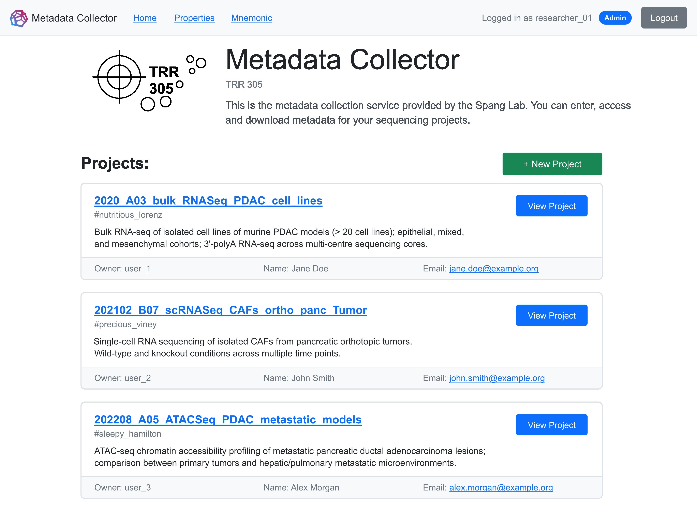
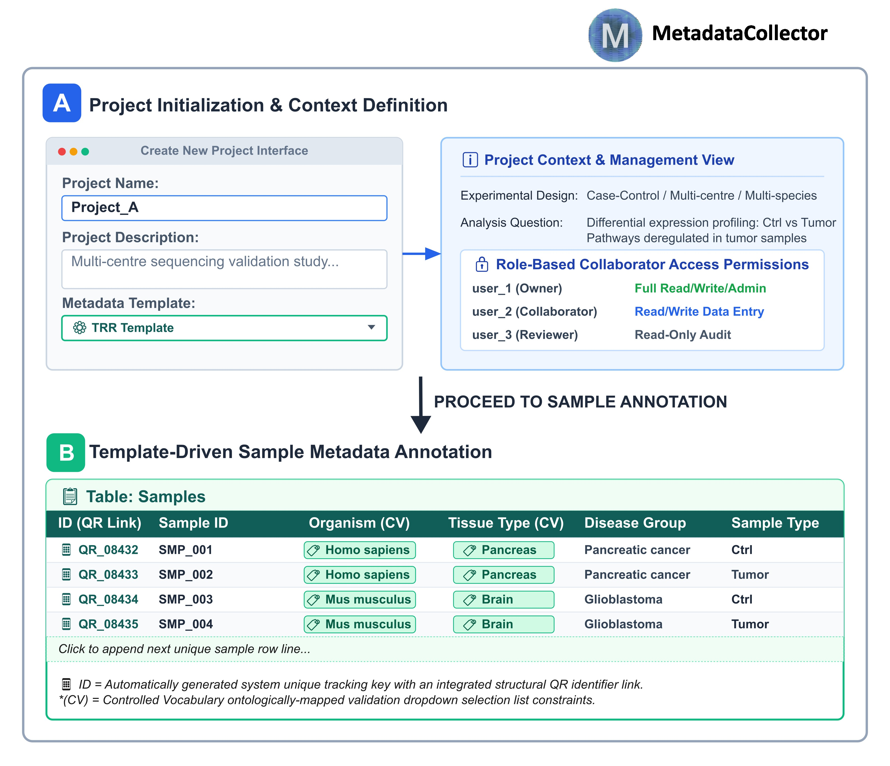

# Metadata Collector: A Web Tool for Standardized Sequencing Metadata in Multi-centre Sequencing Projects

Metadata Collector is an open-source web application designed to coordinate project- and sample-level metadata across research groups and bioinformatics core facilities. Developed in the TRR305 consortium, it provides configurable metadata properties, controlled value selection, project-level access permissions, and event-based history with retrieval of previous annotation states.

What does it do?
- Organizes sequencing metadata into projects and linked sample records.
- Supports configurable fields and constrained input, including selected values and regular-expression validation.
- Allows authorized contributors to access and revise project metadata.
- Records property modifications and supports retrieval of earlier annotation states.
- Provides structured export for downstream workflows (CSV, XLSX).
  
Intended use: metadata coordination during planning, sample annotation, sequencing preparation, and bioinformatics processing. Metadata Collector is not a replacement for a laboratory information management system, ontology authoring platform, or repository submission portal.

  
More detailed information on the platform’s resources and real‑world deployment is available in our preprint https://doi.org/10.64898/2026.06.05.730314.

## Interface preview

<p align="center">
  
</p>

<p align="center">
  
</p>

## Architecture
The public codebase contains a React client, a Node.js/Koa API, and PostgreSQL-backed metadata entities, properties, events, and permissions. Production deployment in TRR305 uses institutional services.

## Software requirements
Node.js: specify an actively supported version tested with the software.
npm: specify the tested major version.
PostgreSQL: specify the tested database version.
Authentication: describe required OpenID Connect provider, local-development mode, and callback URL configuration.
Required environment variables: document names and safe example values in .env.example (never publish credentials).

## Development status
This project is intended for experimentation, testing, and feedback at this stage.

## Installation and local development
The public project currently provides package.json files for the server and client, but a complete independently tested installation sequence has not yet been established in this README.
1. Clone the repository:
```sh
git clone https://github.com/spang-lab/metadata-collector.git
cd metadata-collector
```
2. Configure PostgreSQL and authentication according to docs/configuration.md (to be added).
3. Install server and client dependencies using the tested package-manager commands (to be confirmed).
4. Start the backend and frontend using the tested commands (to be confirmed).
5. Open the documented localhost URL and perform the smoke test below.


## Properties

Every project and sample has associated properties for which users can set values.
The set of properties which can be set can be configured in `config/properties/`, which is a list of property objects:

```yaml
- key: bio_sample_id
  type: sample
  permission: read
  data:
    type: input
    name: Bio Sample ID
    description: Identifer should start with SAMN
    regex: ^SAMN[0-9]{1,10}$
    examples:
      valid:
        - SAMN22222222
      invalid:
        - 123

- key: case_control
  type: sample
  permission: read
  data:
    type: select
    name: Case or Control
    description: Part of the organism under study
    options:
      - case
      - control
      - both
      - none
    examples:
      valid:
        - case
        - control
      invalid:
        - 123
```

Each property must have a `key`, `name` (displayed to users), `description` (for help associated with this property). `visible` can have values `user` (visible to the users), `admin` (visible to the admin), `always` (visible in all cases). If `entity` is set to either `project` or `sample`, the property can only be added to the respective entity.

For input validation, there are several options:

- if `options` are given, valid input must only be one of the given options.
- if `regex` is given, all input must match the regex.

Test cases that are checked when reading the file during runtime can be given as `valid` and `invalid`, where the values are taken as input and validation must return `true` and `false`, respectively.

## Development

You will need a recent version of _nodejs_.

Install the dependecies for the server and client by samplening

```sh
cd seq-meta-data
npm install
cd client
npm install
```

Start the api server

```sh
cd seq-meta-data
npm start
```

and start the development client server

```sh
cd seq-meta-data/client
npm start
```

This will enable hot reloading for client and server changes.

The default url for the server is
http://localhost:8088, please keep the port and use "localhost" instead of "0.0.0.0".
This is required for the auth server user login.

## API

all endpoints prefixed by `/api/v1/`.

All examples are sent with `Content-Type: application/json`, the api will always return `json`.

### Project

The top-level structure. Each project may contain samples. Both project and samples are "entities".

Setting permissions to `null` revokes access to the entity.

Note that these ACLs are only in addition to the owner (the user who created the entity) and to admins (they also may change everything).

## DB schema

### `enum entity_type`

- `none`
- `project`
- `sample`
- `both`

### `enum user_permission`

- `admin` (only visible to admins)
- `owner`
- `read` (only readable by users, editable by admins)
- `write` (editable by users)
- `none`

### Table `entities`

```sql
CREATE TABLE entities (
    id              BIGSERIAL           PRIMARY KEY NOT NULL,
    mnemonic        text                NOT NULL UNIQUE,
    type            entity_type         NOT NULL,
    parent          INTEGER             REFERENCES entities(id),
    owner           text                NOT NULL,
    created         timestamptz         NOT NULL,
    edited          timestamptz         NOT NULL,
    deleted         timestamptz
);
```

### Table `properties`

```sql
CREATE TABLE properties (
    id         BIGSERIAL       PRIMARY KEY NOT NULL,
    type       entity_type     NOT NULL,
    key        text            NOT NULL UNIQUE,
    permission user_permission NOT NULL,
    entity     BIGINT          REFERENCES entities(id),
    data       JSON            NOT NULL
);
```

### Table `events`

```sql
CREATE TABLE events (
    id               BIGSERIAL    PRIMARY KEY NOT NULL,
    entity           BIGINT       NOT NULL REFERENCES entities(id),
    property         BIGINT       NOT NULL REFERENCES properties(id),
    value            text         ,
    owner            text         ,
    timestamp        timestamptz  NOT NULL
);
```

### Table `entity_members`

```sql
CREATE TABLE entity_members (
    id         BIGSERIAL       PRIMARY KEY NOT NULL,
    entity     BIGINT          NOT NULL REFERENCES entities(id),
    sub        text            NOT NULL,
    permission user_permission NOT NULL,
    UNIQUE (entity, sub)
);

```

### Table `entity_columns`

```sql
CREATE TABLE entity_columns (
    id         BIGSERIAL       PRIMARY KEY NOT NULL,
    entity     BIGINT          NOT NULL REFERENCES entities(id),
    property   BIGINT          NOT NULL REFERENCES properties(id),
    sortindex  BIGINT          NOT NULL
);

```
